# 개발 방법론 적용 분석: TDD · DDD · DevOps · OOP · CBD · Spec-Driven

> 상태: 분석 (2026-11-03). 에이전트·스킬은 아직 바꾸지 않았습니다. 마지막 절의 제안을 승인한 뒤 구현합니다.
> 다이어그램: [현재 호출구조](diagrams/call-structure-current.mmd) · [방법론 배치 기준](diagrams/methodology-placement.mmd) · [제안 호출구조](diagrams/call-structure-proposed.mmd) (같은 이름의 `.svg`도 있습니다)

## 1. 결론 먼저

- **방법론마다 에이전트를 만들지 않습니다.** 「TDD 에이전트」「DDD 에이전트」를 두면 v1의 「분야 × 역할」 폭증이 「방법론 × 역할」로 다시 생깁니다. 에이전트는 지금처럼 5개로 둡니다.
- 방법론은 성격에 따라 **세 곳에 나눠 붙입니다.** 이 기준은 [design.md](design.md) §2를 그대로 쓴 것입니다.
  - **과정형**(TDD, Spec-Driven, DevOps): `dev-workflow`의 단계·관문과 사후 스크립트(경계 확인·⑦ 검증)에 붙입니다.
  - **설계 지식형**(DDD, OOP, CBD): 스킬에 붙입니다.
  - **사용자 결정이 필요한 것**(스펙 승인, 용어 확정, 배포): 메인 대화에 둡니다.
  - **호출 전에 막아야 하는 결정적 규칙**(TDD의 테스트 보호, 쓰기 범위, 서브에이전트의 git·배포 명령): 플러그인 hook에 둡니다. 사후 스크립트는 최종 그물로 남깁니다. → §8
- 지금 구조에서 가장 큰 막힘은 **스킬 선택 경로가 하나뿐**이라는 점입니다. `stack-detection`은 매니페스트 의존성과 몇 가지 파일 근거로 스킬을 고릅니다. DDD처럼 저장소에서 근거를 찾을 수 없는 설계 스킬은 이 경로로 **자동 선택될 수 없습니다.** 그래서 두 번째 경로가 필요합니다. 설계자가 근거를 적어 지정하고, 사용자가 ④에서 승인하는 방식입니다.

## 2. 현재 호출구조 분석



| # | 관찰 | 근거 | 방법론 적용에 주는 의미 |
|---|---|---|---|
| F1 | **호출 깊이가 1입니다.** 에이전트 5개 모두 `Agent` 도구가 없어서 다른 에이전트를 부를 수 없습니다. 조율은 전부 메인 대화(`dev-workflow`)가 합니다. | `agents/*.md`의 `tools:` | 과정형 방법론은 **`dev-workflow` 한 곳**에만 넣으면 됩니다. 대신 `dev-workflow`(128줄)가 커지므로, 단계별 세부를 별도 참조 파일로 나눌 시점을 정해야 합니다. |
| F2 | **스킬 선택 경로가 하나**입니다. `stack-detection`은 매니페스트 의존성으로 고르고, 일부는 파일 근거도 씁니다(TypeScript는 `tsconfig.json`·`.ts`, Tauri는 `src-tauri/` 디렉터리). | `skills/stack-detection/SKILL.md` | DDD·OOP·Spec 스킬은 근거가 될 의존성이나 파일이 없어 자동으로 선택되지 않습니다. 반면 DevOps는 `Dockerfile`, `.github/workflows/` 같은 **파일 근거**가 있습니다. 이미 파일 근거를 쓰는 선례가 있으니 경로 1에 행만 더하면 됩니다. |
| F3 | **우선순위 사슬**(프레임워크 > 언어 > 계층 > 공통)에 여러 층을 가로지르는 설계 스킬의 자리가 없습니다. | `code-principles` 「층 사이의 우선순위」 | `domain-modeling`이 `fastapi-standards`의 구조(`features/<도메인>/router·service·repository`)와 부딪히면 어느 쪽이 이기는지 정해지지 않았습니다. → §5-1에서 **A안(별도 축)**으로 결정 |
| F4 | **강제는 사후에 합니다.** 플러그인 에이전트는 frontmatter의 `hooks`·`permissionMode`를 지원하지 않습니다. **(정정)** 플러그인 수준 `hooks/hooks.json`은 서브에이전트 안에서도 실행되어 호출 전 차단이 가능한데, 지금은 쓰지 않습니다. → §8 | `design.md` §8-1, 공식 문서 hooks 「Subagents」 | 새 규칙은 **hook(호출 전)**, **스크립트(사후, 결정적)**, **리뷰어 점검표** 중 하나에 들어가야 효과가 있습니다. 스킬 본문에만 적은 규칙은 권고에 그칩니다. |
| F5 | 미리 로드와 실행 중 로드가 나뉩니다. architect만 계층 스킬 2개를 미리 로드합니다. | `agents/architect.md` | 설계 단계에서 항상 필요한 `domain-modeling`은 **architect만 미리 로드**합니다. tester·developer·reviewer에는 행별 목록으로 넘깁니다. |
| F6 | reviewer는 **관점 인자**로 나뉩니다(code / security). | `agents/reviewer.md` | 설계 검토를 추가할 때 에이전트를 늘릴 필요가 없습니다. 다만 관점을 하나 더 두면 리뷰 비용이 늘어나므로, 설계 스킬이 목록에 있을 때 `code` 관점에 합치는 편이 낫습니다. |
| F7 | **커버리지는 검사하지 않습니다.** `verify.sh`는 포맷·린트·타입·테스트 통과만 보고, 정책은 `decide_exit` 하나입니다. | `skills/verify/scripts/verify.sh:164` | TDD의 RED→GREEN 흐름은 강제되지만, 테스트가 얼마나 덮는지는 강제되지 않습니다. 사용자 전역 규칙(80%)과도 맞지 않습니다. |

## 3. 방법론별 대조



| 방법론 | 유형 | 지금 반영된 정도 | 근거 | 빈틈 | 놓을 곳 |
|---|---|---|---|---|---|
| **TDD** | 과정 | **강함** | tester가 계약만 보고 RED를 확인하고, developer가 GREEN→REFACTOR를 진행합니다. `boundary-check`의 `--protect`가 테스트 수정을 막고, ⑦ⓐ에서 행마다 다시 verify합니다. | 커버리지 게이트가 없습니다(F7). REFACTOR가 실제로 이뤄졌는지 확인하는 지점도 없습니다. | **스크립트**: `verify.sh`에 언어별 커버리지 검사(`pytest --cov-fail-under`, `go test -cover`, `cargo llvm-cov`, `vitest --coverage`)를 더하고, 기준값은 정책 함수로 둡니다. |
| **Spec-Driven** | 과정 | **부분** | architect 설계서(계약 + 인수 조건 + 통합 인수 조건)가 스펙 역할을 합니다. 「계약 문제 → ③으로 되돌림」 규칙은 스펙 우선 순환입니다. | ① 요구사항 산출물에 형식이 없습니다. 인수 조건에 **ID가 없어** 조건에서 테스트로 추적할 수 없습니다. 계약이 머신이 읽는 형식(OpenAPI, JSON Schema)이 아닙니다. 설계 결정 기록(ADR)이 없습니다. 설계서가 날짜별 파일이라 계속 갱신되는 스펙이 아닙니다. | **메인**: ① `REQ-n` 형식. **architect 출력 형식**: `AC-n`, ADR 절. **tester**: 테스트 이름이나 마커에 `AC-n`. **스크립트**: `trace-check.sh`가 모든 `AC-n`에 테스트가 하나 이상 있는지 확인합니다. |
| **DDD** | 설계 지식 (전략은 과정) | **약함** — 폴더 구조만 있습니다 | `code-principles` 「도메인 → 기능」과 공개 진입점 규칙. `fastapi-standards`·`axum-standards`의 `features/<도메인>/service·repository`. | 바운디드 컨텍스트, 유비쿼터스 언어(용어집), 컨텍스트 맵, 애그리거트, 도메인 이벤트는 하나도 없습니다(grep 결과 0건). 값 객체는 `python-standards:26`에 Python 관용구(`frozen` dataclass)로만 나오고, 모델링 규칙으로는 없습니다. 행을 **디렉터리**로 나누고 있고 **컨텍스트**로 나누지는 않습니다. | **전략(과정)**: ①에서 용어집(`docs/domain/glossary.md`)을 확정하고, ③에서 행을 바운디드 컨텍스트 단위로 나눕니다(디렉터리와 컨텍스트가 일치하도록). **전술(지식)**: 새 스킬 `domain-modeling`. 단순 CRUD에는 적용하지 않는 조건을 명시합니다. |
| **OOP** | 설계 지식 | **개념 수준으로 이미 있음** | 의존성 주입(= 의존 역전), 공개 진입점(= 캡슐화)이 `code-principles`에 있습니다. 인터페이스·트레이트·Protocol 관용구는 언어 스킬에 있습니다. | SOLID나 「상속보다 합성」 같은 언어 중립 원칙이 적혀 있지 않습니다. | **`code-principles`에 3~4줄 보강**합니다. 보편적인 「OOP 스킬」은 만들지 않습니다. Go·Rust는 상속이 없어서, 클래스 중심 규칙은 언어 스킬과 충돌합니다. |
| **CBD** | 설계 지식 | **구조적으로 대부분 있음** | 작업 행과 그 계약이 컴포넌트 경계입니다. `boundary-check`가 이 경계를 강제하고, 통합 테스트가 조립을 검증합니다. researcher의 「저장소 안 → GitHub → 레지스트리」 순서는 재사용 탐색입니다. | 계약에 **버전**과 하위 호환 규칙이 없습니다. | **Spec 형식에 합칩니다**: 계약 절에 `version`과 하위 호환 규칙을 넣습니다. 새 장치는 만들지 않습니다. |
| **DevOps** | 과정 + 지식 | **로컬만** | `verify.sh`가 로컬 CI 역할을 합니다. ⑨에서 커밋·PR까지 갑니다. 로그·정상 종료·헬스체크는 `backend-principles`에 있습니다. | CI 설정, 배포·릴리스·롤백, IaC가 없습니다. 추적은 Rust 쪽 `tracing` 관용구(`rust-standards`, `axum-standards`의 추적 미들웨어)에만 있습니다. 계층 수준의 메트릭·분산 추적 지침은 없습니다. CI가 로컬과 같은 명령을 쓰도록 하는 규칙도 없습니다. | **스킬** `devops-standards`(원칙: CI는 `verify.sh`를 호출, 로컬과 CI는 같은 명령). **경로 1**: `stack-detection`에 파일 근거 행 추가. **메인**: ⑩ 배포는 외부로 나가는 작업이라 사용자 승인 관문으로 둡니다. **`backend-principles`**에 관측성 절을 추가합니다. |

## 4. 제안 호출구조



바뀌는 것만 적습니다. **에이전트 수, 호출 깊이, 권한은 그대로입니다.**

| 단계 | 지금 | 제안 | 방법론 |
|---|---|---|---|
| ① 요구사항 | 형식 없음 | `docs/specs/<주제>.md`에 `REQ-n` 형식. 새 도메인 용어는 용어집에 확정 | Spec, DDD(전략) |
| ③ 설계 | 행 = 디렉터리, 인수 조건에 ID 없음 | 행 = 바운디드 컨텍스트(= 디렉터리). `AC-n`, 계약 `version`, `## 설계 결정 (ADR)` 절, `## 설계 스킬` 목록 | DDD, Spec, CBD |
| ④ 승인 | 설계서 + 실행 방식 | **+ 설계 스킬 목록**(경로 2의 근거) | — |
| ⑤ 테스트 | 인수 조건마다 테스트 | 테스트 이름이나 마커에 `AC-n` | Spec, TDD |
| ⑦ 검증 | ⓐ 행 verify → ⓑ 통합 테스트 (경계 확인은 ⑦ 밖에서 ②·⑤·⑥·⑧ 호출마다 감쌈) | ⓐ에 **커버리지 게이트**, **ⓒ `trace-check.sh`** 추가 | TDD, Spec |
| ⑧ 리뷰 | code / security | 설계 스킬이 목록에 있으면 `code` 관점 점검표에 설계 항목(애그리거트 경계, 용어 일치) 추가 | DDD, OOP |
| ⑩ 배포 | 없음 | 메인 대화 + 사용자 승인. CI는 `verify.sh`와 같은 명령 | DevOps |

### 스킬 선택 경로 두 개

| 경로 | 근거 | 선택 주체 | 대상 |
|---|---|---|---|
| 1. `stack-detection` | 매니페스트 의존성, **추가로** `Dockerfile`·`.github/workflows/`·`*.tf` | 규칙(결정적) | 계층·언어·프레임워크 스킬, `devops-standards` |
| 2. 설계 스킬 지정 | architect가 행마다 적는 **이유** (예: 「주문은 상태 전이가 있는 애그리거트」) | architect → 사용자 승인 | `domain-modeling` 등 의존성과 무관한 스킬 |

설계서 출력 형식의 행별 스킬 목록은 다음처럼 바뀝니다.

```
### 스킬 목록: backend/
- 근거: backend/pyproject.toml — fastapi
- 불러올 스킬:            ← 경로 1
  - work-standards:backend-principles
  - work-standards:python-standards
  - work-standards:fastapi-standards
- 설계 스킬:              ← 경로 2 (없으면 "없음")
  - work-standards:domain-modeling — 이유: <한 줄>
```

## 5. 결정이 필요한 것

### 5-1. 설계 스킬의 우선순위 (F3)

`domain-modeling`이 「`service.py`에 업무 로직」(fastapi)과 「애그리거트가 불변식을 지킨다」(DDD) 사이에서 부딪힐 때 어느 쪽을 따를지 정해야 합니다.

| 선택지 | 내용 | 장점 | 단점 |
|---|---|---|---|
| A. 사슬 밖의 **별도 축** | 「어디에 두는가」는 프레임워크가 정하고, 「무엇을 모델링하는가」는 설계 스킬이 정합니다 | 실제 충돌 대부분이 사라집니다(fastapi의 `service.py` 안에 애그리거트를 두면 됨) | 축을 나누는 기준을 설명해야 합니다 |
| B. 계층과 공통 사이 | 프레임워크 > 언어 > 계층 > **설계** > 공통 | 기존 사슬에 한 칸만 넣으면 됩니다 | 프레임워크 관례가 항상 이겨서 DDD가 무력해질 수 있습니다 |
| C. 충돌 시 보고만 | 정하지 않고 `code-principles` 3번(「임의로 고르지 말고 보고」)을 따릅니다 | 지금 규칙을 그대로 씁니다 | 같은 질문이 행마다 반복됩니다 |

**결정: A안(별도 축).** 사용자가 2026-11-03에 선택했습니다.

축은 이렇게 나눕니다.

| 축 | 정하는 것 | 정하는 스킬 | 예 |
|---|---|---|---|
| **위치 축** | 코드를 어느 파일·모듈·프레임워크 구성요소에 두는가, 어떤 API로 쓰는가 | 기존 사슬: 프레임워크 > 언어 > 계층 > 공통 | `features/order/service.py`, 의존성 주입 방식, ORM 호출 |
| **모델 축** | 무엇을 하나의 개념으로 묶는가, 누가 불변식을 지키는가, 무엇이라 부르는가 | 설계 스킬(`domain-modeling` 등) | `Order` 애그리거트, `Money` 값 객체, 용어집의 「주문」 |

- **서로 넘보지 않습니다.**
  - 설계 스킬은 디렉터리나 파일 이름을 정하지 않습니다.
  - 층 스킬은 애그리거트 경계나 용어를 정하지 않습니다.
  - fastapi의 `service.py` 안에 `Order` 애그리거트를 두면 두 축을 모두 만족합니다.
- **불변식은 두 축 모두보다 위입니다.** `code-principles` 「불변식」은 설계 스킬도 완화할 수 없습니다.
- **남는 충돌은 보고합니다(C안을 예외 처리로 씀).**
  - 두 축이 같은 결정을 다투면 임의로 고르지 않고 보고서에 적습니다.
  - 예: 프레임워크가 ORM 모델을 도메인 객체로 쓰라고 하는데, 설계 스킬은 영속성과 분리된 애그리거트를 요구하는 경우.
  - 이런 충돌이 반복되면 그 프레임워크 스킬에 「모델 축과 맞닿는 지점」 절을 추가합니다.

P2에서 `code-principles` 「층 사이의 우선순위」를 다음 문구로 바꿉니다(초안).

```
1. **"어디에·어떻게"는 더 구체적인 층이 정합니다**: 프레임워크 > 언어 > 계층 > 공통.
2. **"무엇을 모델링하는가"는 설계 스킬이 정합니다.** 설계 스킬은 위치를 정하지 않고, 층 스킬은 모델 개념(경계·불변식의 주인·용어)을 정하지 않습니다.
3. **아래 「불변식」은 어떤 층도, 어떤 설계 스킬도 완화할 수 없습니다.**
4. 두 스킬이(같은 축이든 두 축 사이든) 정말로 충돌하면 임의로 고르지 말고 보고서에 적습니다.
```

`domain-modeling` 스킬 머리말에는 「이 스킬은 모델 축만 정합니다. 파일 위치는 계층·프레임워크 스킬을 따릅니다」를 넣습니다. ⑧ 리뷰의 `code` 관점 점검표에는 「축 침범」(설계 스킬이 위치를 바꾸거나 층 스킬이 모델 경계를 바꿈) 항목을 추가합니다.

### 5-2. 커버리지 기준

- 기준값(전역 규칙은 80%)과 측정 단위(행 디렉터리 / 변경된 줄)를 정해야 합니다.
- 커버리지 도구가 없을 때 `skip`을 통과로 볼지도 정해야 합니다. 지금 `decide_exit` 기본값은 `skip`도 차단합니다.

### 5-3. DDD 적용 조건

모든 작업에 전술 DDD를 적용하면 과합니다. architect가 `domain-modeling`을 지정하는 기준이 필요합니다. 예를 들면 「상태 전이나 불변식이 둘 이상인 도메인」입니다.

## 6. 구현 제안 (우선순위순)

| 순위 | 항목 | 바뀌는 파일 | 강제 방식 | 크기 |
|---|---|---|---|---|
| P1 | 커버리지 게이트 | `skills/verify/scripts/verify.sh`, `skills/verify/SKILL.md` | 스크립트 | 중 |
| P1 | 인수 조건 ID와 추적 | `agents/architect.md`(출력 형식), `agents/tester.md`, `skills/dev-workflow/scripts/trace-check.sh`(신규), `dev-workflow` ⑦ⓒ | 스크립트 | 중 |
| P1 | 스킬 선택 경로 2 | `agents/architect.md`, `skills/stack-detection/SKILL.md`, `dev-workflow` 핸드오프 형식 | 승인 관문 | 소 |
| P2 | `domain-modeling` 스킬, 용어집, 컨텍스트 단위 행 분할 | `skills/domain-modeling/`(신규), `agents/architect.md`, `code-principles` 우선순위 | 리뷰 점검표 | 중 |
| P2 | Spec 형식: `REQ-n`, ADR, 계약 버전 | `dev-workflow` ①④, `agents/architect.md` | 승인 관문 | 소 |
| P2 | OOP 언어 중립 원칙 보강 | `skills/code-principles/SKILL.md` | 리뷰 점검표 | 소 |
| P3 | `devops-standards`, 파일 근거 판별, ⑩ 배포 관문, 관측성 절 | `skills/devops-standards/`(신규), `stack-detection`, `dev-workflow`, `backend-principles` | 승인 관문 + 스크립트 | 대 |

P1 세 항목 가운데 「인수 조건 추적」과 「선택 경로 2」는 `agents/architect.md`와 `skills/dev-workflow/SKILL.md`를 함께 고칩니다. 그래서 병렬로 진행하지 않고 순차로 진행합니다. 「커버리지 게이트」는 `verify` 스킬만 건드리므로 따로 진행할 수 있습니다.

## 7. 하지 않기로 한 것

- **방법론별 에이전트**: F1과 §1의 이유로 만들지 않습니다.
- **보편 OOP 스킬**: Go·Rust 관용구와 충돌하므로 만들지 않습니다.
- **CBD 전용 장치**: 행·계약·`boundary-check`가 이미 컴포넌트 경계 역할을 합니다.
- **서브에이전트의 배포 실행**: 외부로 나가는 작업이므로 메인 대화가 사용자 승인 뒤에만 합니다.

## 8. Hook 검토 (추가, 2026-11-03)

### 8-1. 왜 앞의 분석에서 빠졌는가

- **전제를 검증 없이 물려받았습니다.**
  - F4의 근거인 `design.md` §8-1은 「플러그인 에이전트는 `hooks`·`permissionMode`를 지원하지 않는다」고 씁니다.
  - 이 문장은 **에이전트 frontmatter**에 대해서만 맞습니다.
  - 공식 문서(sub-agents 「Choose the subagent scope」)는 같은 자리에서 플러그인 작성자라면 hook을 **플러그인의 `hooks/hooks.json`** 에 두라고 안내합니다. 그 hook은 플러그인이 켜져 있는 동안 서브에이전트 안에서도 실행됩니다.
- **배치 기준에 hook 칸이 없었습니다.**
  - `design.md` §2는 메인 대화·에이전트·스킬·스크립트 네 칸으로 나눕니다.
  - 이 분석도 그 틀을 그대로 따랐습니다(§1, [배치 다이어그램](diagrams/methodology-placement.svg)).
  - 그 결과 「결정적인 규칙」은 모두 경계 확인·⑦ 검증 스크립트, 즉 **사후** 확인으로만 갔습니다. **호출 전에 막는다**는 시점 축이 빠져 있었습니다.

### 8-2. 공식 문서로 확인한 것

| 항목 | 내용 | 출처 |
|---|---|---|
| 서브에이전트 안에서 실행 | 플러그인 hook의 `PreToolUse`·`PostToolUse`가 서브에이전트의 도구 호출에도 발동합니다 | hooks 「Subagents」 |
| 호출한 에이전트 식별 | 공통 입력 필드 `agent_id`, `agent_type`. 플러그인 에이전트는 `work-standards:developer` 형식입니다(**실측 확인**, §8-7) | hooks 「Common input fields」, sub-agents |
| 실행 전 차단 | `PreToolUse`에서 exit 2 또는 `permissionDecision: "deny"`. `updatedInput`으로 인자를 바꿀 수도 있습니다 | hooks 「Exit codes」·「JSON output」 |
| 종료 거부 | `SubagentStop`에서 `decision: "block"` + `reason`을 주면 서브에이전트가 그 이유를 다음 지시로 받아 계속 작업합니다 | hooks 「SubagentStop decision control」 |
| 스킬 호출 관찰 | `Skill` 도구도 `PreToolUse`·`PostToolUse` 매처로 잡힙니다. 입력은 `{"skill": "<플러그인>:<스킬>"}`입니다(**실측 확인**, §8-7) | hooks 「UserPromptExpansion」 |
| 끌 수 있음 | 사용자 `disableAllHooks`, 관리 설정 `allowManagedHooksOnly`로 꺼질 수 있습니다 | hooks, plugins/security |

### 8-3. 바뀌는 배치 기준



결정적인 규칙은 이제 **시점**으로 한 번 더 나눕니다.

- **피해가 생기기 전에 막아야 하고, 도구 호출 하나만 보고 판정할 수 있으면 hook(`PreToolUse`)에 둡니다.**
- **변경 전체를 봐야 판정할 수 있으면(행 경계, 커버리지, 추적) 사후 스크립트(경계 확인·⑦)에 둡니다.**

hook은 사후 스크립트를 **대체하지 않습니다.** hook은 사용자나 관리 설정으로 꺼질 수 있고, Bash 명령 문자열 검사는 우회할 수 있습니다. 그래서 hook은 **앞단 가드레일**, 사후 스크립트는 **최종 그물**로 둡니다(심층 방어).

### 8-4. hook 후보

| # | 이벤트 · 매처 | 대상 (`agent_type`) | 하는 일 | 메우는 빈틈 | 방법론 |
|---|---|---|---|---|---|
| H1 | `PreToolUse` · `Write\|Edit\|MultiEdit\|NotebookEdit` | `developer` | 테스트 파일 수정을 거부합니다 | 보호 테스트 수정을 지금은 `boundary-check.sh`가 **사후에** 잡습니다 | TDD |
| H2 | 같음 | `tester` | 테스트 파일이 아닌 경로에 쓰기를 거부합니다 | RED 단계에서 구현이 섞이는 것 | TDD |
| H3 | 같음 | `developer`, `tester` | 저장소(작업 디렉터리) 밖, `.env`·`.git/` 쓰기를 거부합니다 | `design.md` §8-1 「무시된 경로·저장소 밖 쓰기」 | 공통 불변식 |
| H4 | `PreToolUse` · `Bash` | `work-standards:*` 전부 | `git commit/push/stash/tag/checkout -b`, 배포 명령을 거부합니다. `curl`·`wget`은 `researcher`만 허용합니다 | §8-1 「git 메타데이터·네트워크」, §7 「서브에이전트의 배포 실행 금지」 | DevOps |
| H5 | `PreToolUse` · `Write\|Edit\|Bash` 쓰기 | `reviewer`, `researcher` | 쓰기를 모두 거부합니다. 둘 다 「읽기」 역할인데 `Bash`가 있어 `tools` 목록만으로는 막히지 않습니다 | 읽기 전용 역할의 우회 쓰기. 저장소 안 쓰기는 지금 `boundary-check.sh --strict`가 ②·⑧ 모두 **사후에** 잡습니다. H5는 저장소 밖 쓰기와 원격 부작용(`gh` 쓰기 명령)을 호출 전에 막기 위해 여전히 필요합니다 | — |
| H6 | `PostToolUse` · `Skill` | `work-standards:*` 전부 | `agent_id`, `agent_type`, 스킬 이름을 `.work-standards/skill-log.jsonl`에 남깁니다 | §8-1 「스킬을 실제로 불러왔는지는 자기 보고」. `trace-check.sh`가 설계서의 스킬 목록과 대조합니다 | Spec |
| H7 | `SubagentStop` | `developer` | `verify.sh`(+커버리지)가 실패하면 `block`하고 실패 요약을 다음 지시로 돌려줍니다 | ⑥→⑦ 왕복을 서브에이전트 안에서 끝냅니다 | TDD |

- **H1–H6은 판정이 싸고 결정적입니다.** H7은 테스트 실행 비용이 들고, 무한 반복을 막는 장치(`stop_hook_active`, 재시도 상한)가 필요하므로 따로 결정합니다.
- **행 단위 경계는 hook에 넣지 않습니다.** 병렬로 띄운 developer의 `agent_id`와 담당 행을 hook이 알 방법이 문서에 없습니다. 행 경계는 지금처럼 `boundary-check.sh`가 맡습니다(worktree 격리를 쓰면 H3이 부분적으로 대신합니다).
- **실측으로 정해진 구현 조건(§8-7):** H1–H3은 절대 경로를 `cwd` 기준으로 바꾼 뒤 판정합니다(R6). H4는 `cd ... &&` 접두와 `git -C` 같은 전역 옵션을 건너뛰고 하위 명령을 봅니다(R7). H6에는 frontmatter로 미리 로드한 스킬이 남지 않습니다(R4).

### 8-5. 설계 제약

1. **플러그인 hook은 플러그인이 켜진 모든 세션에 걸립니다.** 사용자의 다른 작업과 메인 대화를 건드리지 않도록, 모든 hook은 먼저 `agent_type`이 `work-standards:` 에이전트인지 확인하고 아니면 즉시 통과(exit 0)합니다.
2. **실측이 먼저입니다.** `agent_type`의 실제 값과 `Skill` 입력 필드 이름은 문서에 없었습니다. 로그만 남기는 hook으로 다섯 에이전트를 한 번씩 돌려 확인했습니다(§8-7). 규칙은 그 결과를 기준으로 씁니다.
3. ~~JSON 파싱 의존성을 정해야 합니다.~~ **`python3`(3.9 이상, 표준 라이브러리만)로 정했습니다(P1).** `jq`는 요구하지 않습니다. 경로 정규화(심볼릭 링크·대소문자)와 git 호출을 bash 3.2로 안전하게 쓰기 어려웠기 때문입니다. hook 실행 환경의 PATH에 `python3`가 없으면 exit 127로 fail-open되므로, 그때는 경계 확인만 남습니다.
4. **Bash 명령 검사는 휴리스틱입니다.** `sh -c`, 변수 치환 등으로 우회할 수 있으므로 보안 경계로 쓰지 않고, 사후 스크립트(경계 확인·⑦)를 최종 판정으로 남깁니다.
5. **`design.md` §8-1 문구를 바로잡아야 합니다.** 「막을 수 없다」가 아니라 「에이전트 frontmatter로는 못 막고, 플러그인 hook으로 막는다」로 바꿉니다.

### 8-6. 우선순위 반영

| 순위 | 항목 | 바뀌는 파일 |
|---|---|---|
| ~~P0~~ 완료 | hook 실측: 로그만 남기는 `PreToolUse`·`PostToolUse` hook으로 `agent_type` 값과 `Skill` 입력 형식을 확인 → §8-7 | `hooks/hooks.json`(신규), `hooks/log-only.sh`(임시) |
| ~~P1~~ 완료 | H1·H2·H3(TDD·불변식 쓰기 가드), H6(스킬 로딩 기록) → §8-8 | `hooks/hooks.json`, `hooks/_common.py`, `hooks/write_guard.py`, `hooks/skill_log.py`, `hooks/tests/`, `dev-workflow` ⑤→⑥ |
| P2 | H4·H5(Bash 가드), `design.md` §8-1 정정 | `hooks/*.sh`, `docs/design.md` |
| P3 | H7(`SubagentStop` 자동 검증) | `hooks/*.sh`, `dev-workflow` ⑦ⓐ |

H6은 §6의 「인수 조건 추적」(`trace-check.sh`)과 이어지므로 그 항목 다음에 진행합니다.

### 8-7. P0 실측 결과 (2026-11-03)

**방법**

- 작은 Python 저장소(scratch)에서 `claude -p --plugin-dir <플러그인 루트> --setting-sources project`로 세션 하나를 띄웠습니다. 사용자 전역 hook은 끄고 플러그인 hook만 남겼습니다.
- 메인 대화가 `Skill`을 한 번 직접 부르고, 다섯 에이전트를 차례로 불렀습니다. architect·tester·developer·reviewer는 각각 `Skill`을 한 번씩 불렀습니다.
- `hooks/log-only.sh`가 `PreToolUse`(전체), `PostToolUse`(`Skill`), `SubagentStart`, `SubagentStop` 입력을 기록했습니다. 기록은 60건입니다.

**확인한 사실**

| # | 사실 | 근거 (기록 건수) | hook 설계에 주는 의미 |
|---|---|---|---|
| R1 | hook이 다섯 에이전트 **모두**의 안에서 발동합니다 | `SubagentStart`·`SubagentStop` 각 5건, 서브에이전트 `PreToolUse` 39건 | H1–H7을 플러그인 `hooks/hooks.json` 하나로 걸 수 있습니다 |
| R2 | `agent_type`은 `work-standards:researcher` 형식입니다. 메인 대화의 기록에는 `agent_type`·`agent_id` 키가 **아예 없습니다**(null이 아님) | 서브에이전트 기록 전부, 메인 `Skill`·`Agent` 기록 7건 | 필터는 「키가 없거나 `work-standards:`로 시작하지 않으면 통과」로 씁니다 |
| R3 | `Skill` 입력은 `{"skill": "work-standards:python-standards"}`, `PostToolUse` 응답은 `{"success": true, "commandName": "..."}`입니다 | `PostToolUse`·`Skill` 5건 | H6은 `tool_input.skill`과 `tool_response.success`만 읽으면 됩니다 |
| R4 | frontmatter `skills:`로 **미리 로드한 스킬은 `Skill` 이벤트를 만들지 않습니다** | 미리 로드한 스킬 기록 0건 | H6 기록에는 실행 중 부른 스킬만 남습니다. `trace-check.sh`는 미리 로드 목록을 에이전트 frontmatter에서 읽어 합쳐야 합니다 |
| R5 | `PreToolUse`는 **권한 검사보다 먼저** 발동합니다 | 권한으로 거부된 15건도 모두 기록됨 | 권한 모드와 상관없이 hook이 시도 자체를 봅니다. 거부 판정이 겹쳐도 해가 없습니다 |
| R6 | `file_path`는 **절대 경로**입니다. `cwd`는 서브에이전트 안에서도 메인 세션의 작업 디렉터리입니다. 단 `isolation: "worktree"`로 띄우면 `<메인 toplevel>/.claude/worktrees/agent-<id>`입니다(P1 실측, §8-8) | `Read`·`Edit`·`Glob` 기록 전부 | H1–H3은 `cwd`(또는 `git rev-parse --show-toplevel`) 기준 상대 경로로 바꾼 뒤 판정합니다 |
| R7 | Bash 명령은 `cd "<절대 경로>" && ...`, `git -C <경로> diff`, `uv run ...`, `bash "<플러그인 루트>/skills/verify/scripts/verify.sh"` 형태로 옵니다 | tester 10건, developer 12건 | H4는 `cd ... &&` 접두와 `git -C`·전역 옵션을 건너뛰고 하위 명령을 봐야 합니다. `git diff`·`git status` 같은 읽기 명령은 허용해야 합니다 |
| R8 | `SubagentStart`에는 `agent_id`·`agent_type`만 있고 프롬프트·스킬 목록은 없습니다. `SubagentStop`에는 `last_assistant_message`, `agent_transcript_path`, `stop_hook_active`가 있습니다 | 각 5건 | 행 경계를 hook이 알 수 없다는 §8-4의 판단이 맞습니다. H7은 `stop_hook_active`로 반복을 막을 수 있습니다 |
| R9 | 메인 대화의 `Agent` 호출 입력에 `subagent_type`이 들어 있습니다 | `PreToolUse`·`Agent` 5건 | 서브에이전트 호출 자체를 메인 대화 쪽에서 검사하는 지점으로도 쓸 수 있습니다 |

**남은 것**

- ~~`hooks/log-only.sh` 정리~~ P1에서 지웠습니다.
- ~~JSON 파싱 의존성~~ P1에서 `python3`로 정했습니다(§8-5 3번).

### 8-8. P1 구현 결과 (2026-11-04)

**구성**

| 파일 | 역할 |
|---|---|
| `hooks/hooks.json` | `PreToolUse`(`Write\|Edit\|MultiEdit\|NotebookEdit`) → `write_guard.py`, `PostToolUse`(`Skill`) → `skill_log.py`. 둘 다 timeout 10초. `python3 -B`로 실행해 플러그인 디렉터리에 `__pycache__`를 남기지 않습니다(실제 세션에서 생기는 것을 확인하고 추가) |
| `hooks/_common.py` | 입력 해석, `work-standards:` 필터, 경로 정규화(`canonical_path`), git 저장소 판정, 상태 루트 후보(`state_candidates`) |
| `hooks/write_guard.py` | H3 → H1(developer) / H2(tester) 순서로 판정. 거부는 `permissionDecision: "deny"` JSON + exit 0 |
| `hooks/skill_log.py` | H6. `.work-standards/skill-log.jsonl`에 `ts`·`session_id`·`agent_id`·`agent_type`·`skill`·`success`를 한 줄씩 덧붙임(`O_APPEND`) |
| `hooks/tests/` | unittest 68개. 임시 git 저장소에서 hook을 하위 프로세스로 실행. `python3 -B -m unittest discover -s hooks/tests` |

**정해진 규칙**

- **H1 보호 목록은 파일 이름 패턴이 아니라 메인 대화가 쓰는 목록입니다.** developer는 TDD로 자기 단위 테스트를 쓰므로(`developer.md` 3단계) `test_*` 패턴으로 막을 수 없습니다. 메인 대화가 developer 호출 직전에 `.work-standards/protected-paths`에 `boundary-check.sh --protect`와 같은 목록을 씁니다. 파일이 없으면 H1은 통과합니다.
- **상태 디렉터리 `.work-standards/`는 `.gitignore`에 `*` 한 줄**을 둬서 자신까지 무시시킵니다. 그래야 `boundary-check.sh`의 `git ls-files --others --exclude-standard`가 hook 파일을 위반으로 세지 않습니다.
- **상태 루트는 조상 방향으로 찾습니다.** 세션 toplevel에서 시작해 부모 디렉터리의 toplevel 중 common-dir이 같은 것을 후보로 모읍니다. H1은 `protected-paths` 파일이 있는 가장 가까운 후보를, H6은 `.work-standards/` 디렉터리가 있는 가장 가까운 후보를 씁니다. 격리 worktree가 조정자 작업 트리 안에 중첩되어 생기기 때문입니다(R6).
- **H2 tester의 테스트 밖 쓰기**는 `tester_may_write_non_test()`가 정합니다. 기본값은 「git이 추적 중인 파일은 거부, 새 파일은 허용(빈 껍데기)」입니다. `TODO(사용자)`로 팀 정책을 고르게 남겼습니다.
- **경로 비교:** 대상은 `normpath` 없이 `realpath`로 풀고(파일 링크·끊긴 링크·`link/..`), 존재하는 구성 요소의 디스크 표기를 복원합니다. 거부 쪽 비교(`.git`, `.work-standards`, `.env*`, 보호 항목)는 casefold로, 허용 쪽 비교(테스트 경로)는 정확 비교로 합니다.
- **git 발견 오류**는 「저장소 아님」(`not a git repository (or any of the parent directories)`)만 저장소 밖으로 보고, 나머지 exit 128은 내부 오류(exit 1, fail-open)로 처리합니다. `.git` 구성 요소가 있는 대상은 저장소 판정 전에 거부합니다.

**리뷰 반영** (codex·agy, 2026-11-04)

| 지적 | 등급 | 처리 |
|---|---|---|
| worktree cwd에서 H1이 꺼지고 H6 로그가 흩어짐 | HIGH | 상태 루트 후보 탐색. 실측으로 cwd 확인 후 설계 |
| macOS 대소문자 별칭(`.Env`, `.WORK-STANDARDS/`, `src/CALC.py`)으로 H1–H3 우회 | HIGH(agy CRITICAL) | 디스크 표기 복원 + 거부 쪽 casefold |
| 파일 심볼릭 링크·끊긴 링크 미해석 | HIGH(agy CRITICAL) | `realpath`로 대체 |
| `link/..`를 링크 해석 전에 접음 | HIGH | `normpath` 선행 제거 |
| 보호 항목과 대상의 표현 불일치(링크 디렉터리) | MEDIUM | 항목을 lexical·canonical 두 형태로 보호 |
| 보호 항목 `.`이 아무것도 보호하지 않음 | MEDIUM | `.`·`./`·절대 루트 → 전체 보호(`boundary-check.sh`와 같게) |
| 모든 git exit 128을 「저장소 아님」으로 봄 | MEDIUM | 문구로 구분, 나머지는 fail-open |

**실제 세션 검증** (`claude -p --plugin-dir`, scratch 저장소, `protected-paths`에 `tests/acceptance`)

| 에이전트 | 쓰기 대상 | 결과 |
|---|---|---|
| developer | `tests/acceptance/test_calc.py` | 거부(H1) |
| developer | `src/new_mod.py` | 허용 |
| developer | `.env` | 거부(H3) |
| developer | `../outside.txt` | 거부(H3, 저장소 밖) |
| developer | `.Work-Standards/protected-paths` | 거부(H3, 대소문자 별칭) |
| tester | `src/calc.py`(추적 중) | 거부(H2) |
| tester | `tests/test_new.py` | 허용 |
| tester | `src/stub_mod.py`(새 파일) | 허용 |
| developer, `isolation: "worktree"` | `tests/acceptance/test_calc.py` | 거부(H1, 조정자의 목록을 찾음) |
| developer, `isolation: "worktree"` | `src/wt_mod.py` | 허용 |
| developer, `isolation: "worktree"` | `Skill(work-standards:code-principles)` | H6 기록 1줄이 **조정자의** `.work-standards/skill-log.jsonl`에 남음(worktree 쪽 로그 없음) |

서브에이전트는 거부 이유를 읽고 재시도·우회 없이 보고했습니다. `.work-standards/`는 `git status`에 나타나지 않았습니다.

**남은 것**

- **격리 worktree 디렉터리가 조정자에서 미추적으로 보입니다.** `git status`에 `?? .claude/worktrees/agent-<id>/`가 나타납니다. 병렬 모드에서 `boundary-check.sh`가 이를 범위 밖 위반으로 셀 수 있으므로, P2에서 `classify_out_of_scope`나 제외 규칙으로 다룹니다.
- **중첩 저장소·submodule 안 쓰기는 「저장소 밖」으로 거부됩니다.** common-dir이 다르기 때문입니다. submodule을 고쳐야 하는 작업은 메인 대화가 직접 하거나 정책을 따로 정해야 합니다.
- **`python3`가 hook PATH에 없으면 fail-open**입니다(exit 127). 경계 확인이 최종 그물입니다.
- **세션 cwd가 조정자와 다른 저장소**이면 조정자 목록을 찾지 못하고 H1이 통과합니다.
- P2(H4·H5 Bash 가드, `design.md` §8-1 정정), P3(H7)는 아직 하지 않았습니다. 그 사이 researcher와 reviewer는 본문의 `Bash` 허용 명령 목록과 ②·⑧의 `--strict` 경계 확인으로 버팁니다.
