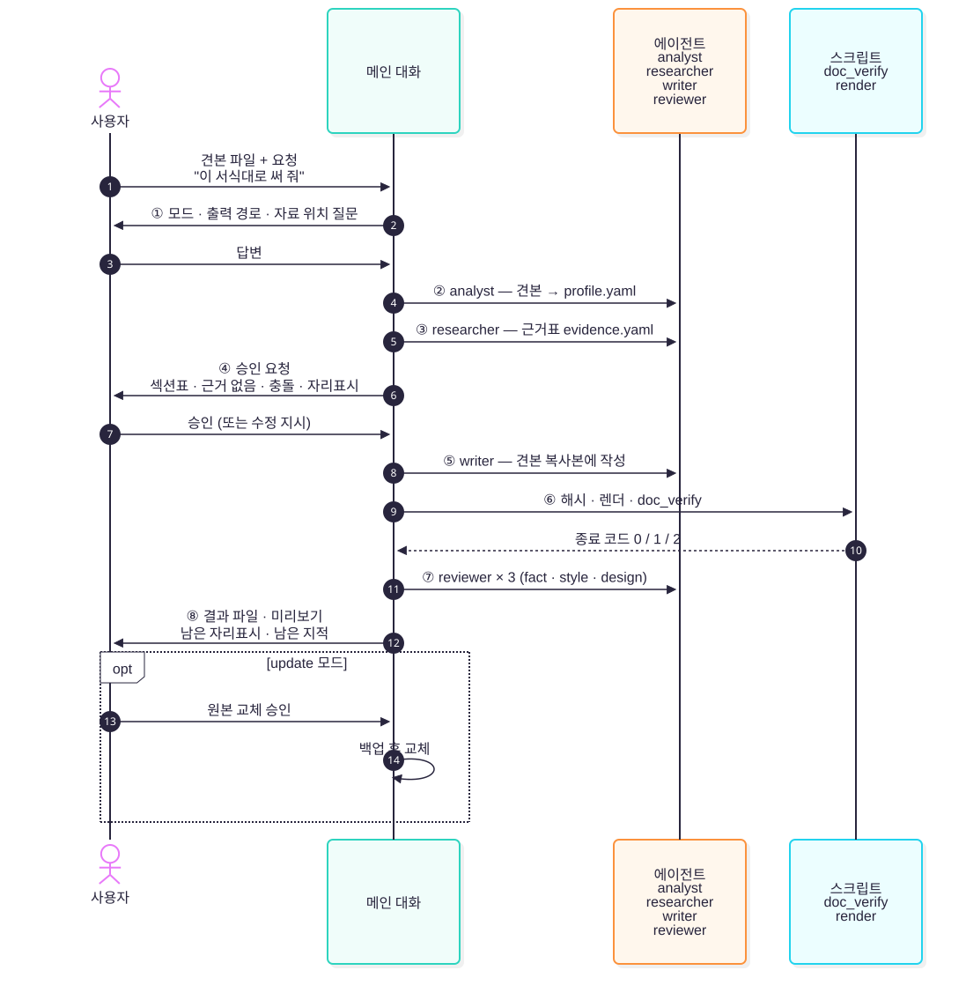

# docu-writer 사용 매뉴얼

견본·양식 파일을 주면 **견본의 모양은 그대로 두고 내용만** 채워 주는 Claude Code 플러그인입니다. 이 매뉴얼은 설치, 요청하는 법, 중간에 사용자가 답할 곳, 결과를 읽는 법을 다룹니다. 설계 배경은 [design.md](design.md)에 있습니다.

## 1. 현재 상태 (v0.3.0, 2026-11-06)

> **견본 우선(1단계)에 더해 견본 없는 신규 작성(2단계)이 들어왔습니다.** 테스트 401건이 통과합니다. 2단계 종단 점검은 docx·hwpx·md 신규 작성 각 1건과, 법제처 공개 서식으로 만든 고정 견본 1건(기안문, `form` 모드)으로 했습니다. 1단계 시험 결과는 [13장](#13-종단-시험-결과-2026-11-04)에, v0.3.0 회귀 종단 시험 결과는 [14장](#14-회귀-종단-시험-2026-11-06-v030)에 있습니다.



| 구분 | 항목 | 상태 |
|---|---|---|
| 규칙 | 에이전트 5개(`planner` 추가), 스킬 13개(`newdoc-workflow` 채움) | 완료 |
| 테스트 | `tests/` 13개 파일, 401건 (리뷰 회귀, 종단 시험 회귀 포함) | **401 통과** (10장) |
| 스크립트 | 1단계 6개(`write_guard.py`, `profile_extract.py`, `patch_docx.py`, `patch_pptx.py`, `render.py`, `doc_verify.py`) + 2단계 `catalog.py`, `doc_verify.py` 신규 모드, `planner` 역할 hook | 완료 |
| 테마 | 기본 DOCX 테마 `newdoc/templates/themes/docx/default.docx`(+토큰), HWPX는 kordoc 프리셋 | 완료 |
| 시험 | 1단계 9개 경로(13장), 2단계 신규 3개 형식 + 고정 견본 `form` 1건(경로 B·동봉 프로파일 포함), v0.3.0 회귀 종단(14장) | **완료** |
| 리뷰·배포 | codex·agy 리뷰, git.agentthread.dev push | 1단계 반영 완료, 2단계는 이번 리뷰로 반영 |

알아 둘 한계는 다음과 같습니다.

- **실제 업무 문서**: 종단 시험은 시험용으로 만든 가상 견본(추진계획·주간 보고·신청서 양식)을 썼습니다. 병합 셀이 아주 많은 표, 글상자가 많은 HWPX처럼 실제 문서에서만 나오는 경우는 아직 확인하지 못했습니다.
- **kordoc 출력은 `docu-writer-out/`을 거칩니다**: kordoc 쓰기 도구는 숨김 경로(`.docu-writer/`)에 쓰지 않습니다. 작업 폴더에 잠깐 `docu-writer-out/`이 생겼다가 옮긴 뒤 지워집니다(6장).
- **PPTX 슬라이드 복제(`slide_dup`)**: 차트는 원본과 같은 차트 데이터를 가리키고, 애니메이션·전환 효과와 발표자 노트는 복사되지 않습니다.
- **견본 보호**: hook이 `docu-writer:*` 에이전트의 쓰기를 막지만 `Bash`로 쓴 것은 보지 못합니다. ⑥의 해시 대조가 마지막 그물입니다. `.docu-writer/protected-paths`가 없거나 읽을 수 없으면 hook은 reviewer 외 역할의 쓰기도 모두 막습니다(닫힌 쪽 실패).
- **writer의 쓰기 범위**: writer는 계약 파일·견본 밖이면 어디든 쓸 수 있습니다(`.git/`·`.claude/` 포함). 결과 경로를 고정하지 않는 설계라서 그대로 두었습니다.

## 2. 설치

**방법 A — 플러그인 하나만 시험할 때**

```bash
claude --plugin-dir <이 저장소>/docu-writer
```

**방법 B — 마켓플레이스로 설치할 때.** Claude Code 대화창에서 저장소 최상위를 마켓플레이스로 더한 뒤 설치합니다. `work-standards`(developer)도 같은 마켓플레이스에 있습니다.

```text
/plugin marketplace add <이 저장소>
/plugin install docu-writer@skills-for-work
```

설치되면 에이전트는 `docu-writer:analyst`처럼, 스킬은 `docu-writer:template-workflow`처럼 이름 앞에 플러그인 이름이 붙습니다.

## 3. 필요한 도구

| 도구 | 쓰는 곳 | 확인 명령 |
|---|---|---|
| `uv` (Python 3.13) | 모든 스크립트 | `uv --version` |
| LibreOffice `soffice` | DOCX·PPTX·MD 렌더 | `soffice --version` |
| `pandoc` | MD 렌더 | `pandoc --version` |
| kordoc MCP (`moai-officer` 플러그인) | HWPX·HWP 분석·작성·렌더 | 대화에서 `/mcp` 목록에 kordoc |
| `npx` | 도표 렌더 (`@mermaid-js/mermaid-cli`) | `npx -y @mermaid-js/mermaid-cli --version` |

Ghostscript는 필요 없습니다. PDF → PNG는 pymupdf가 맡습니다.

## 4. 빠른 시작

견본 파일 경로와 함께 평소 말로 요청하면 됩니다. 메인 대화가 `template-workflow` 스킬을 불러 모드를 정합니다.

| 하고 싶은 일 | 요청 예 | 모드 |
|---|---|---|
| 같은 서식으로 새 내용 쓰기 | 「`~/견본/주간보고.hwpx` 서식대로 11월 1주 주간보고 써 줘. 자료는 `~/자료/11월/`에 있어」 | `sample` |
| 양식 빈칸 채우기 | 「`신청서.docx` 양식을 이 정보로 채워 줘: 성명 홍길동, 소속 …」 | `form` |
| 문서 일부만 고치기 | 「`사업계획.pptx`의 추진 일정 장만 12월 기준으로 고쳐 줘」 | `update` |

요청에 넣으면 질문이 줄어드는 것:

- **출력 경로** — 견본과 같은 경로는 안 됩니다. 이미 있는 파일 이름이면 다시 묻습니다.
- **자료 위치** — 폴더·파일. 웹 검색을 해도 되는지도 함께 적습니다.
- **분량·줄여도 되는 섹션** — 표가 한 쪽에 안 들어갈 때 무엇을 줄일지 정해 줍니다.

견본 없이 새 문서를 만들 때는 2단계 `newdoc-workflow`가 「문서 종류」와 「출력 형식」(md·docx·hwpx)만으로 경로를 고릅니다.



- **고정 견본** — 카탈로그에 그 종류·형식의 견본이 있으면 항목의 `mode`에 따라 1단계 `sample`(본문 있는 견본) 또는 `form`(기안문처럼 칸만 있는 법정 서식)으로 넘어갑니다. 항목에 `profile:`로 미리 만든 프로파일을 동봉하면 `profile_extract.py check`가 통과할 때 견본 분석(②)을 건너뜁니다.
- **테마**(기본) — planner가 목차를 짜고, writer가 Markdown으로 쓴 뒤 테마를 입혀 변환합니다.
- **기본값** — 테마가 없으면(md 등) 변환 도구 기본 서식이며, ④에서 「기본 서식」이라고 알립니다.
- **견본 더하기** — `~/.config/docu-writer/templates/catalog.yaml`(또는 `$DOCU_WRITER_TEMPLATES`)에 `fixed` 항목을 한 줄 더하고 파일을 옆 폴더에 둡니다. 플러그인 갱신에 덮어쓰이지 않습니다. 형식은 `docs/design.md` §9.3, 점검은 `uv run newdoc/skills/newdoc-workflow/scripts/catalog.py check`.

## 5. 진행 순서와 사용자가 할 일

사용자가 답하는 곳은 세 군데입니다. **① 질문, ④ 승인, ⑧ 원본 교체 승인(update 모드)**. 나머지는 메인 대화와 에이전트가 진행합니다.



| 단계 | 누가 | 사용자가 할 일 |
|---|---|---|
| ① 요구사항·모드 판별 | 메인 대화 | 모드·출력 경로·자료 위치 질문에 답함 |
| ② 견본 분석 | analyst | 없음 |
| ③ 근거 조사 | researcher | 없음 |
| ④ 승인 | 사용자 | 승인 화면을 읽고 승인하거나 고칠 점을 말함 |
| ⑤ 작성 | writer | 없음 |
| ⑥ 검증 | 메인 대화 + 스크립트 | 없음 (실패하면 ⑤로 자동 되돌림) |
| ⑦ 리뷰 | reviewer × 3 | 없음 (같은 지적이 세 번 반복되면 보고받음) |
| ⑧ 전달 | 메인 대화 | 결과 확인. update 모드면 원본 교체 여부를 따로 답함 |

### 5.1 ④ 승인 화면 읽는 법

승인 전에는 작성(⑤)으로 넘어가지 않습니다. 한 번에 다음을 보여 줍니다.

| 항목 | 볼 점 |
|---|---|
| 모드·견본·출력 경로 | 의도와 맞는가 |
| 섹션 표 (id · 제목 · kind · 분량 · 근거 수 · 근거 없음) | 「근거 없음」이 많은 섹션은 자리표시 `○○`로 남습니다. 값을 알면 이때 알려 주십시오 |
| form 모드의 칸 표 | 칸마다 들어갈 값과 제약 |
| 비운 디자인 토큰, 편집 불가 개체 | 글상자·필드·SmartArt처럼 손대지 못하는 것 |
| 충돌 | 요청과 견본이 어긋난 곳. 견본을 따르며, 견본에 없는 섹션은 추가하지 않습니다 |
| 자리표시 예정 | 남을 칸과 이유 |

고칠 점을 말하면 메인 대화가 `profile.yaml`·`evidence.yaml`을 고치고 다시 보여 줍니다. 승인하면 두 파일의 해시를 `approved.sha256`에 고정하고, 이후 에이전트가 바꾸면 ⑥·⑦에서 잡힙니다.

### 5.2 ⑧ 결과 보고 읽는 법

| 받는 것 | 뜻 |
|---|---|
| 결과 파일 경로, 쪽별 미리보기 | 1~3쪽 PNG를 대화에 직접 보여 줍니다 |
| 남은 자리표시 표 | `○○`로 남은 칸. 근거가 없어 지어내지 않은 곳입니다 |
| 줄인 내용 | 표를 한 쪽에 넣으려고 줄인 문장 |
| 적용하지 못한 편집, 편집 불가 개체 안내 | 예: 「Word에서 목차 필드 업데이트」, 「차트 데이터는 PowerPoint에서 수정」 |
| 남은 MEDIUM·LOW 지적 | CRITICAL·HIGH는 ⑤로 되돌려 고친 뒤라 남지 않습니다 |
| 근사 렌더 안내 | HWPX는 「한컴에서 쪽 나눔 확인 권장」 |

검증 결과의 원본은 `.docu-writer/verify/report.json`입니다. 검사 13개가 언제나 모두 들어가며 `status`는 넷 중 하나입니다.

| status | 뜻 |
|---|---|
| `pass` | 통과 |
| `fail` | 차단. 하나라도 있으면 종료 코드 1, ⑤로 되돌림 |
| `warn` | 의심. 예: 표가 쪽 경계에 걸렸을 수 있음(`r1_tables`) → ⑦에서 사람 눈(리뷰어)이 판정 |
| `skip` | 해당 없음. 예: MD에는 서체·쪽 정보가 없음 |

### 5.3 update 모드 — 원본 교체와 되돌리기

에이전트는 어느 모드에서도 원본에 쓰지 않습니다. 고친 결과는 먼저 `.docu-writer/work/<이름>.updated.<확장자>`에 생깁니다. ⑧에서 원본 경로·백업 경로·바뀐 섹션을 보여 주고 **따로 승인을 받은 뒤에만** 메인 대화가 교체합니다.

교체할 때는 순서대로 다음을 합니다.

1. 원본이 ① 이후 바뀌지 않았는지 해시로 확인합니다. 다르면 멈추고 보고합니다(다른 사람이 고쳤을 수 있음).
2. 원본을 `.docu-writer/backup/이름.시각.확장자`로 복사합니다. 예: `사업계획.20261104-153012.pptx`
3. 결과로 원본을 덮고 두 해시가 같은지 확인합니다.

되돌리려면 백업을 원본 경로로 복사합니다.

```bash
cp -p ".docu-writer/backup/사업계획.20261104-153012.pptx" "/경로/사업계획.pptx"
```

## 6. 작업 디렉터리 `.docu-writer/`

작업을 시작한 디렉터리에 `.docu-writer/`가 생깁니다. 안의 `.gitignore`가 전부 무시하므로 저장소에 올라가지 않습니다.



| 파일 | 만드는 단계 | 내용 |
|---|---|---|
| `session.yaml` | ① | 모드, 견본 경로와 sha256, 출력 경로 |
| `protected-paths` | ① | 에이전트가 쓰면 안 되는 경로(견본 등) |
| `profile.yaml` | ② | 양식 프로파일: 구조·번호 체계·문체·디자인 토큰·칸 |
| `evidence.yaml` | ③ | 섹션·칸별 근거와 출처 |
| `approved.sha256` | ④ | 승인 시점의 profile·evidence 해시 |
| `placeholders.yaml` | ⑤ | 남긴 자리표시 목록 |
| `work/` | ②·⑤ | 표 추출, 골격, 편집 목록, update 결과 |
| `render/` | ②·⑥ | 쪽별 PNG·SVG, `pages.json`. `render/source/`는 견본 렌더 |
| `verify/` | ⑥ | `report.json`, `output.sha256` |
| `backup/` | ⑧ | update 모드 원본 백업 |

작업이 끝나면 지워도 됩니다. 단, update 모드의 `backup/`은 되돌릴 일이 없을 때까지 두십시오.

HWPX 작업 중에는 `.docu-writer/` 옆에 `docu-writer-out/`이 잠깐 생깁니다. kordoc 쓰기 도구(`patch_document`·`fill_form`·`render_document` 등)가 `.`으로 시작하는 숨김 경로에 쓰지 않기 때문입니다. 에이전트가 이 폴더에 낸 파일을 `.docu-writer/` 안으로 옮기고 폴더를 지웁니다. 작업이 끝났는데 남아 있으면 옮기다 멈춘 것이니 안을 확인한 뒤 지우십시오. hook은 analyst에게 `.docu-writer/`와 이 폴더만 쓰게 하고, 이 폴더가 심볼릭 링크면 막습니다.

## 7. 형식별 주의

| 형식 | 경로 | 주의 |
|---|---|---|
| HWPX | kordoc MCP (`patch_document`·`fill_form`·`render_document`) | kordoc 렌더는 근사입니다. 최종 쪽 나눔은 한컴오피스에서 확인하십시오. `<결과>.rewrite.hwpx`가 생기면 제자리 반영에 실패한 것이라 ⑥이 막습니다 |
| HWP | kordoc `convert_to_hwpx`로 바꾼 뒤 HWPX와 같음 | 결과는 HWPX로 나옵니다. 원본 HWP와 변환본 해시를 둘 다 대조합니다 |
| DOCX | `patch_docx.py` | 글상자·필드·SmartArt는 고치지 못하고 보고만 합니다. 목차는 Word에서 필드 업데이트가 필요합니다 |
| PPTX | `patch_pptx.py` | 차트 데이터·SmartArt는 PowerPoint에서 고쳐야 합니다. 발표자 노트는 ④에서 내용으로 다룰지 정합니다 |
| Markdown | 직접 편집, 렌더는 pandoc → soffice | 쪽 개념이 없어 쪽·서체 검사는 `skip`입니다 |
| PDF | 견본으로만 읽음 | 고칠 수 없습니다. 원본(HWPX·DOCX 등)을 주십시오 |

## 8. 디자인 규칙 R1~R6

결과물은 다음 여섯 규칙으로 검수합니다. 정본은 `skills/design-review/SKILL.md`입니다.

| 규칙 | 내용 | 검사 |
|---|---|---|
| R1 | 표는 한 쪽 안에 표시합니다. 넘치면 **내용을 줄입니다** | 스크립트(의심) + 리뷰어(판정) |
| R2 | 표·글상자 크기는 가능하면 쪽 안에 모두 들어가야 합니다 | 리뷰어 |
| R3 | 고아 줄을 최대한 줄입니다 | 리뷰어 |
| R4 | 같은 수준의 제목은 같은 크기·서체로 표현합니다 | 스크립트 |
| R5 | 문서 전체의 양식(서체·크기·색·표 서식·여백)을 통일합니다 | 스크립트 + 리뷰어 |
| R6 | 글 번호 양식을 통일합니다 | 스크립트 |

**글자 크기나 여백을 줄여서 맞추지 않습니다.** 표를 한 쪽에 넣으려고 토큰을 바꾸면 R5 위반입니다.

## 9. 스크립트 직접 실행

> 인자와 종료 코드는 각 스킬의 `SKILL.md`가 계약이고, `tests/`가 그 계약을 검사합니다.

플러그인 안에서는 `${CLAUDE_SKILL_DIR}`가 각 스킬 디렉터리를 가리킵니다. 직접 실행할 때는 실제 경로로 바꿉니다.

```bash
# 견본 표 추출과 프로파일 점검 (template-analysis)
uv run template/skills/template-analysis/scripts/profile_extract.py tables <견본> > .docu-writer/work/tables.yaml
uv run template/skills/template-analysis/scripts/profile_extract.py check .docu-writer/profile.yaml \
  --source <견본> --tables .docu-writer/work/tables.yaml

# DOCX·PPTX 골격 덤프와 편집 적용 (format-docx / format-pptx)
uv run skills/format-docx/scripts/patch_docx.py dump <견본.docx> --out .docu-writer/work/skeleton.yaml
uv run skills/format-docx/scripts/patch_docx.py apply <견본.docx> \
  --edits .docu-writer/work/edits.yaml --profile .docu-writer/profile.yaml --out <결과.docx>

# 렌더와 검증 (doc-verify)
uv run skills/doc-verify/scripts/render.py <결과 파일> .docu-writer/render/
uv run skills/doc-verify/scripts/doc_verify.py \
  --profile .docu-writer/profile.yaml \
  --source <견본> --expect-sha256 <①에서 기록한 값> \
  --output <결과 파일> \
  --placeholders .docu-writer/placeholders.yaml \
  --pages-dir .docu-writer/render/ \
  --out-dir .docu-writer/verify/
```

| 종료 코드 | 뜻 |
|---|---|
| 0 | 통과 (`doc_verify`는 `warn`·`skip`만 있을 때) |
| 1 | 차단. `patch_*`는 파일을 쓰지 않음, `doc_verify`는 `fail`이 있음 |
| 2 | 사용법·환경 오류(경로 없음, 도구 없음, 출력 파일이 이미 있음). **통과가 아닙니다** |

## 10. 개발자용 — 테스트

```bash
cd <이 저장소>/docu-writer
uv run --python 3.13 --with pytest,python-docx,python-pptx,pyyaml,lxml,pymupdf pytest tests
```

2026-11-06 실행 결과는 `401 passed`입니다(약 90초, `test_render.py`·`test_render_fonts.py`는 `soffice`·`pandoc`이 있어야 합니다). lint는 `uvx ruff check --select F,E9 hooks template/skills/template-analysis/scripts skills/*/scripts newdoc/skills/*/scripts tests`로 봅니다.

종단 시험에서 나온 회귀 테스트는 docstring에 「종단 시험 F번호」를 적어 두었습니다. `test_e2e_chain.py`(③→⑥ 연결), `test_render_fonts.py`(F3), `test_workflow_snippets.py`(F2, SKILL.md의 셸 명령을 그대로 실행)가 이때 생겼습니다.

`samples` 픽스처가 DOCX·PPTX·MD 견본을 한꺼번에 만들므로, 한 파일만 돌릴 때도 `--with`에 `python-docx`와 `python-pptx`를 모두 넣어야 합니다. 각 스크립트는 자기 의존성을 PEP 723 블록에 적어 두므로 `--with` 목록은 pytest 쪽에만 필요합니다.

스크립트가 없을 때 `uv run`은 종료 코드 2로 끝납니다. 그래서 「거부·exit 2」를 기대하는 테스트가 저절로 통과하는 거짓 양성이 있었습니다(49건). 지금은 `conftest.py`의 `uv()`와 `test_write_guard.py`의 `run_guard()`가 스크립트 파일이 있는지 먼저 확인합니다.

스크립트를 만들 때 쓴 작업 지시서는 [briefs/](briefs/)에 있습니다. 스크립트를 고칠 때도 이 지시서와 각 `SKILL.md`가 계약입니다.

| 지시서 | 대상 |
|---|---|
| `brief_hook.md` | `hooks/write_guard.py`, `hooks/hooks.json` |
| `brief_pe.md` | `profile_extract.py` |
| `brief_pd.md` | `patch_docx.py` |
| `brief_pp.md` | `patch_pptx.py` |
| `brief_rv.md` | `render.py`, `doc_verify.py` |

## 11. 문제 해결

| 증상 | 원인과 조치 |
|---|---|
| `uv`가 의존성을 받지 못함 | 처음 실행할 때 python-docx·python-pptx·pymupdf를 내려받습니다. 네트워크를 확인하거나 한 번 직접 실행해 캐시를 채우십시오 |
| HWPX 작업이 시작되지 않음 | kordoc MCP가 연결되지 않았습니다. `moai-officer` 플러그인을 켜고 `/mcp`로 확인하십시오 |
| DOCX·PPTX 렌더 실패 (종료 코드 2) | `soffice`가 PATH에 없습니다. LibreOffice를 설치하십시오 |
| 결과에 `○○`가 많음 | 근거 자료가 부족합니다. ④에서 값을 직접 주거나 자료 위치를 더 알려 주십시오 |
| 같은 지적으로 멈춤 | ⑦에서 같은 지적이 세 번 반복되면 멈추고 보고합니다. 견본 자체의 한계(예: 표 칸 부족)인 경우가 많습니다 |
| update 교체가 거부됨 | ① 이후 원본이 바뀌었습니다. 다른 사람이 고친 것인지 확인한 뒤 처음부터 다시 하십시오 |

## 12. 제한 사항

- 견본 없이 새 문서를 쓰는 `newdoc`의 테마는 DOCX 기본 테마 하나와 kordoc HWPX 프리셋뿐입니다. MD는 테마가 없어 기본 서식으로 만듭니다.
- `form` 모드는 견본 문구 잔존(`residue`)을 보지 않습니다. 라벨과 안내 글이 한 칸에 든 법정 서식은 프로파일 `fields`의 `re:` 제약으로 안내 글이 남는 것을 막습니다(`format-hwpx` 「양식 채우기」).
- 렌더는 근사입니다. HWPX는 한컴, DOCX는 Word에서 최종 확인이 필요합니다.
- hook은 `Bash`로 쓰는 파일을 보지 못합니다. 그래서 ⑥의 해시 대조가 최종 방어선입니다.
- 견본 서식을 바꾸는 일(서체 변경, 섹션 추가)은 하지 않습니다. 견본과 요청이 충돌하면 견본을 따르고 보고만 합니다.
- 종단 시험에서 확인했지만 고치지 않은 한계는 13.4에 있습니다.

## 13. 종단 시험 결과 (2026-11-04)

각 `SKILL.md`에 적힌 명령을 그대로 따라 9개 경로를 처음부터 끝까지 돌렸습니다. 견본은 시험용으로 만든 가상 문서이고, 양식에 넣은 개인정보도 가상 값입니다. 시험 중 문서나 도구가 틀린 곳이 나오면 그 자리에서 고치고 회귀 테스트를 붙였습니다.

### 13.1 경로별 결과

| 형식 | 모드 | 견본 | 최종 | 시험 중 나온 일 |
|---|---|---|---|---|
| HWPX | sample | 추진계획.hwpx | 통과 | 요약 상자에 `> `가 글자로 새어 든 결과를 새 `markup` 검사가 막음(F12). `> `를 떼고 다시 써서 통과. 숨김 경로 렌더 거부(F13), 한 쪽 렌더 이름(F14), `1.1` 번호(F11) |
| HWPX | form | 출장 신청서.hwpx | 통과 (`fields` 칸 7개) | 전화번호 형식을 틀린 결과를 `fields`가 막음. 그 보고에 칸 값이 그대로 찍혀 고침(F16) |
| HWPX | update | 추진계획.hwpx | 통과 | 고칠 섹션 밖(s3) 표 칸을 바꾼 결과를 `scope`가 막음 |
| DOCX | sample | 주간 보고.docx | 통과 | 사실 문구를 잔여로 잡음(F1), 렌더 글꼴(F3) |
| DOCX | form | 수강 신청서.docx | 통과 | 칸 이름표가 지문 후보로 샘(F4), `re:` 제약 문서 없음(F5), R1 쪽 글 대조(F6), 양식 섹션에 length 요구(F7) |
| DOCX | update | 주간 보고.docx | 통과 | ③을 건너뛰면 ④ 명령이 반쪽 승인을 남김(F2, DOCX 시험 중 절차를 따르다 발견) |
| PPTX | sample | 주간 보고.pptx | 통과 | — |
| PPTX | form | 회의실 신청 양식.pptx | 통과 | 날짜 칸 `re:` 제약이 정상 값을 떨어뜨림(F9), R6이 날짜 연도를 번호로 봄(F10) |
| PPTX | update | 주간 보고.pptx | 통과 | 장을 복제하자 섹션 위치가 밀려 정상 결과가 `scope` 실패(F8). 슬라이드 id로 찾게 고친 뒤 통과 |

「막음」은 일부러 틀리게 만든 결과를 검사가 제대로 잡았다는 뜻입니다. HWPX의 세 가지 막는 경로(`markup`·`fields`·`scope`)는 모두 종료 코드 1로 ⑦에 넘어가지 못했습니다.

### 13.2 찾아서 고친 결함

| # | 문제 | 고친 곳 |
|---|---|---|
| F1 | residue가 판마다 그대로 이어지는 사실 문구를 견본 잔여로 잡음 | template-analysis: 그런 값은 지문(`sample_text`)에서 뺌. doc-verify: 정당한 글이 잡히면 writer는 사실을 바꾸지 않고 analyst가 지문을 고친 뒤 ④ 재승인 |
| F2 | update에서 ③을 건너뛰면 `evidence.yaml`이 없는데, ④ 명령이 실패하면서도 profile 한 줄짜리 `approved.sha256`을 남김 | template-workflow ④ 명령, `test_workflow_snippets.py` |
| F3 | macOS LibreOffice가 시스템 글꼴을 못 찾아 한글을 빈 글리프로 그리는데, 쪽 글은 멀쩡해 검사가 못 알아챔 | `render.py` 글꼴 설정과 글리프 점검, `test_render_fonts.py` |
| F4 | 양식 칸 이름표가 `sample_text` 후보로 샘 | `profile_extract.py` `drop_field_labels` |
| F5 | `re:` 제약 쓰는 법이 문서에 없어, 문서를 따른 analyst가 검사할 수 없는 자연어 제약을 씀 | template-analysis SKILL.md |
| F6 | LibreOffice가 ○를 대체 글꼴로 그리면 쪽 글 순서가 바뀌어 R1이 표 칸을 못 찾음 | `_checks_design.py` R1 낱말 대조 |
| F7 | form 모드 섹션(양식 뼈대)에도 length를 요구함 | `profile_extract.py check`·doc-verify `length`가 form 섹션을 건너뜀 |
| F8 | PPTX 장 복제·삭제 뒤 `sl:N` 섹션이 밀림 | `_locate.py` `slide_anchor`가 견본 슬라이드 id로 찾음 |
| F9 | `re:` 제약이 전체 일치(fullmatch)라는 사실이 문서에 없어 부분 패턴이 정상 값을 떨어뜨림 | template-analysis SKILL.md |
| F10 | R6이 날짜의 연도(「2026. 11. 12.」)를 번호로 봄 | `_checks_design.py` `YEAR` |
| F11 | 끝 점 없는 다단 번호 `1.1`을 profile_extract와 doc-verify가 다르게 봄 | `_pe_common.py` `MARKER_RE` |
| F12 | kordoc `patch_document`가 요약 상자에 `> `를 글자로 넣는데 잡는 검사가 없음 | doc-verify `markup` 검사 추가(검사 13개), format-hwpx 「함정」 |
| F13 | kordoc `render_document`가 숨김 경로에 쓰지 않음 | 렌더 절차를 `docu-writer-out/` 경유로 바꿈 |
| F14 | 한 쪽만 렌더하면 접미 없는 `page.svg`가 나와 doc-verify가 못 읽음 | `doc_verify.py`가 둘 다 읽고 섞이면 사용 오류, 옮길 때 `page*` |
| F15 | 렌더뿐 아니라 kordoc 쓰기 도구 전부가 숨김 경로를 거부함 | 모든 kordoc 출력을 `docu-writer-out/` 경유로, hook이 analyst에게 이 폴더를 허용(심볼릭 링크는 거부) |
| F16 | `fields` 위반 보고에 칸 값(개인정보일 수 있음)이 그대로 나옴 | 값 대신 글자 수만 냄(kordoc `fields_file` 마스킹과 같게) |

### 13.3 hook 실동작 확인

단위 테스트는 hook 스크립트에 JSON을 넣어 봅니다. 여기서는 `claude -p --plugin-dir docu-writer`로 플러그인을 실제로 띄우고, analyst·writer 서브에이전트가 직접 쓰게 했습니다(HWPX form 작업 폴더 복사본).

| # | 에이전트 | 시도 | 기대 | 결과 |
|---|---|---|---|---|
| 1 | analyst | `Write` → `.docu-writer/work/smoke-a.md` | 허용 | 허용, 파일 생김 |
| 2 | analyst | `Write` → 작업 폴더의 `smoke-root.md` | 거부 | 거부 「analyst는 .docu-writer/ 안(계약 파일 제외)과 docu-writer-out/ 안에만 쓸 수 있습니다」, 파일 없음 |
| 3 | analyst | kordoc `render_document` → `docu-writer-out/page.svg` | 허용 | 허용, SVG 생김 |
| 4 | writer | `Write` → `.docu-writer/profile.yaml` | 거부 | 거부 「writer는 계약 파일과 profile.yaml·evidence.yaml을 쓸 수 없습니다」, 내용 그대로 |
| 5 | writer | `Write` → 견본 `출장 신청서.hwpx` | 거부 | 거부 「견본(protected-paths)은 읽기 전용입니다」, sha256 시험 전후 같음 |

거부는 모두 `PreToolUse:Write` hook에서 나왔고, 에이전트는 거부된 호출을 다시 시도하지 않았습니다.

### 13.4 확인했지만 고치지 않은 한계

| 영역 | 한계 | 대처 |
|---|---|---|
| PPTX form | 자리표시(placeholder)만 칸으로 봅니다. 표·글상자 안 칸은 아직 아닙니다 | 그런 양식은 ②에서 보고 |
| DOCX form | 병합되지 않은 칸의 이름표는 왼쪽 칸 글로 추정합니다 | ④ 승인 화면에서 칸 이름 확인 |
| residue | LibreOffice 대체 글꼴로 쪽 글 순서가 바뀌면 남은 문구에 쪽 번호를 못 붙일 수 있습니다 | 판정은 문서 글 기준이라 그대로입니다 |
| 범위 | 패처(`patch_docx`·`patch_pptx`·kordoc)는 섹션 범위를 지키지 않습니다 | doc-verify `scope`가 섹션 밖 변경을 막습니다 |
| HWPX 렌더 | AI가 만든 HWPX는 근사 렌더입니다(조판 캐시 없음) | 쪽 경계 판정은 한컴에서 확인 |
| HWPX R6 | 부호가 문단 자동 번호 서식이면 문단 글에 부호가 없어 R6이 보지 못합니다 | ⑦ 리뷰어가 렌더로 확인 |
| HWPX 프로파일 | `profile_extract.py profile`은 DOCX·PPTX·MD만 초안을 만듭니다 | analyst가 `parse_document`·`extract_profile`로 직접 씀 |
| kordoc | `> ` 새어 듦(F12), 거짓 「반영 안 된 편집 있음 (수정 1)」, `parse_document`에서 첫 ○가 안 보임, 숨김 경로 쓰기 거부(F13·F15) | 문서 절차와 `markup` 검사로 비켜 감. kordoc 쪽 수정이 필요 |
| 권한 | reviewer는 `Write` 도구가 없습니다(첫째 방어선). hook은 둘째 방어선입니다 | — |
| 시험 양식 | 칸이 좁아 전화번호가 줄바꿈됩니다 | 파이프라인 결함이 아니라 양식 설계 문제 |

## 14. 회귀 종단 시험 (2026-11-06, v0.3.0)

v0.3.0(HEAD)에서 1단계 시험 산출물을 지금 스크립트로 다시 검증하고, 2단계 신규 작성을 처음부터 다시 돌렸습니다. 견본·양식 값은 13장과 같은 가상 자료입니다.

### 14.1 1단계 회귀 — 19/19 일치

13장 작업 폴더마다 `profile_extract.py check` → (DOCX·PPTX) `render.py` → `doc_verify.py`를 다시 돌려 종료 코드와 실패 검사를 기대값과 맞췄습니다.

| 구분 | 사례 | 기대 | 결과 |
|---|---|---|---|
| 정상 | 9개 경로 결과 + PPTX update 대조군(`nodup`, s2만 고침) | 종료 0 | 10건 일치 |
| 음성 | HWPX sample `> ` 새어 듦 | `markup` 실패 | 일치 |
| 음성 | 양식 칸 형식 위반 (HWPX·DOCX 전화번호, PPTX 날짜) | `fields` 실패 | 3건 일치 |
| 음성 | 섹션 밖 변경 (HWPX s3 표 칸, DOCX 범위 밖 문단, PPTX 범위 밖 장 삭제·복제) | `scope` 실패 | 4건 일치 |
| 음성 | PPTX sample 견본 문구 남김 | `residue` 실패 | 일치 |

update 경로는 ⑧에서 원본을 결과로 바꿨으므로 `.docu-writer/backup/`의 원본을 `--source`로 씁니다. `nodup`은 F8을 고치기 전에는 `scope` 실패였던 사례로, 지금은 통과해야 하는 대조군입니다.

### 14.2 2단계 신규 작성

`catalog.py match`로 경로를 고르고, `mode: new` 프로파일(장 5개, 모두 `h:` anchor)과 초안으로 형식마다 결과를 만든 뒤 `doc_verify.py`(새 모드, `--source` 없음)로 검증했습니다.

| 형식 | 경로 | 만든 도구 | 결과 |
|---|---|---|---|
| DOCX | `theme` (기본 테마) | pandoc `--reference-doc` | 종료 0 |
| MD | `none` | 초안 그대로 복사 | 종료 0 |
| HWPX | `theme` (kordoc 프리셋 「보고서」) | `generate_document` → `render_document` SVG | 종료 0. 1쪽 끝에 제목만 남고 표가 2쪽으로 넘어감(⑦ 리뷰어가 볼 조판 문제) |

일부러 틀린 입력도 넣었습니다.

| 시도 | 기대 | 결과 |
|---|---|---|
| `route.json`이 있는데 `catalog.py match` 다시 실행 | 종료 2 | 일치 |
| `catalog.py match --format pptx` | 종료 2 | 일치 |
| DOCX에 Heading 4 사용 | `r5` 실패 | 일치 |
| DOCX에 Block Text(인용) 사용 | `r5` 실패 | 일치 |
| DOCX 본문에 `**` 남김 | `markup` 실패 | 일치 |
| `--source`만 주고 `--expect-sha256` 없음 | 종료 2 | 일치 |
| 필수 장 제목 바꿈(「기대 효과」→「효과 전망」) | `length` detail에 못 찾은 장 기록 | **불일치** → F17로 고침 |

### 14.3 찾아서 고친 결함

| # | 문제 | 고친 곳 |
|---|---|---|
| F17 | 새 모드에서 장 제목(`h:` anchor)을 못 찾아도, 그 장의 분량이 `chars`가 아니라 `lines`·`pages`·`slides`이면 `length` detail에 아무것도 남지 않음. 계약(doc-verify SKILL 「신규 모드」)은 못 찾은 섹션을 detail에 적으라고 함 | `_checks_content.py` `_section_length`가 분량 키와 상관없이 「섹션 시작을 찾지 못해 섹션 분량 skip」을 남김, `test_new_mode_missing_section_noted_for_any_length_key` |

### 14.4 남은 판단과 다시 돌리지 않은 것

- **필수 장 누락은 여전히 종료 0입니다.** 계약상 못 찾은 섹션은 `skip`이고 판정은 ⑦ 리뷰어 몫입니다. `required: true` 장이 없으면 새 모드에서 실패로 볼지 검토했고, 지금처럼 detail에만 남기기로 정했습니다(2026-11-06). 새 모드는 planner가 목차를 정하고 writer가 제목을 다듬을 수 있어, 제목 문구가 달라진 것만으로 막으면 거짓 실패가 많기 때문입니다.
- 이번 회귀에서는 HWPX·MD 새 모드 음성 사례와 고정 견본(`fixed`) 경로를 다시 돌리지 않았습니다. 고정 견본은 2단계 종단 점검(N8)에서 확인했고, HWPX·MD 새 모드 음성은 단위 테스트(`test_new_mode_hwpx_shape_ids_skip`, `test_new_mode_md_output_skips_markup`)만 있습니다.
- `claude -p`로 플러그인을 띄우는 hook 실동작 시험(13.3)은 다시 돌리지 않았습니다. 대신 11-04 이후 `planner` 역할이 들어온 `write_guard.py`에 DOCX 신규 작업 폴더 기준 JSON을 넣어 확인했습니다.

| # | 에이전트 | 쓰기 대상 | 기대 | 결과 |
|---|---|---|---|---|
| 1 | planner | `.docu-writer/work/plan.md` | 허용 | 허용 |
| 2 | planner | `.docu-writer/profile.yaml` | 허용 | 허용 |
| 3 | planner | 작업 폴더의 `plan-root.md` | 거부 | 거부 「planner는 .docu-writer/ 안(계약 파일 제외)과 docu-writer-out/ 안에만…」 |
| 4 | planner | `.docu-writer/approved.sha256` | 거부 | 거부 (계약 파일) |
| 5 | planner | 기본 테마 `default.docx` (`protected-paths`) | 거부 | 거부 「견본(protected-paths)은 읽기 전용입니다」 |
| 6 | writer | 기본 테마 `default.docx` | 거부 | 거부 (같은 이유) |
| 7 | writer | `.docu-writer/profile.yaml` | 거부 | 거부 「writer는 계약 파일과 profile.yaml·evidence.yaml을 쓸 수 없습니다」 |
